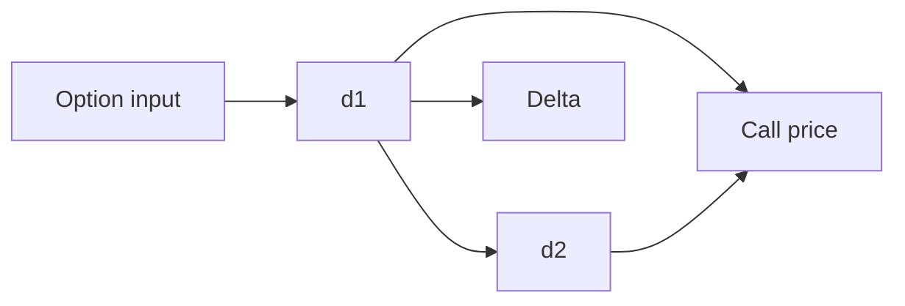

# Pricing DAG

A C++17 project that computes European call option prices and delta using the Black–Scholes model. It implements the same calculations in two ways: sequential loops and an asynchronous directed acyclic graph (DAG).

The focus is dependency management: sharing intermediate results, running independent work concurrently, and understanding when scheduling costs outweigh the work being scheduled.

## Project layout

| Directory | Implementation |
| --- | --- |
| `sync_dag/` | Loads inputs into five vectors, calculates all prices, then calculates all deltas. |
| `async_dag/` | Loads `OptionInput` records and launches an independent pricing DAG for each option. |

Both versions separate CSV ingestion, pricing calculations, and delta calculations. Each includes a Makefile and sample data. Python scripts generate synthetic inputs or fetch market inputs; Python is optional when using the supplied CSVs.

## Calculation and dependencies

For spot `S`, strike `K`, time to expiry `T`, risk-free rate `r`, and volatility `sigma`:

```text
d1    = [ln(S / K) + (r + sigma² / 2) × T] / (sigma × sqrt(T))
d2    = d1 - sigma × sqrt(T)
Call  = S × N(d1) - K × exp(-r × T) × N(d2)
Delta = N(d1)
```

`N` is the standard normal cumulative distribution function, implemented with `std::erfc`. Time is in years; rates and volatility are annualized decimals, so `0.05` means 5%.

The asynchronous dependencies are:



Each row launches one outer task and four calculation tasks with `std::async(std::launch::async)`. A `std::shared_future<double>` lets `d2`, delta, and price consume the same `d1` result. Calls to `.get()` wait for dependencies and propagate task exceptions. Results are collected in input order, and the main thread writes the CSV.

The sequential version recomputes `d1` in its separate price and delta loops. The asynchronous version shares it, but introduces task creation and synchronization overhead.

## Build and run

Requires a C++17 compiler with threading support and GNU Make. These commands use a Unix-style shell, such as Linux, WSL, or MSYS2 with GCC installed. Run from the project root:

```sh
cd sync_dag
make
./sync_dag

cd ../async_dag
make
./async_dag
```

Run each executable from its own directory: input filenames are hardcoded and resolved against the working directory.

| Executable | Input | Output |
| --- | --- | --- |
| `sync_dag` | `market_data.csv` | `priced_options_output.csv` |
| `async_dag` | `market_data_real.csv` | `priced_options_output.csv` |

Input must have a header followed by five numeric columns in this order:

```csv
Spot,Strike,Time,Rate,Volatility
100,100,1,0.05,0.2
```

Output preserves those columns and appends `CallPrice,Delta`. For the example above, the expected values are approximately `10.4506` and `0.636831`. Each run overwrites its output and prints elapsed time in microseconds.

## Data

The supplied CSVs each contain 482 rows. The sequential default input has different maturity values from the asynchronous default input, so the default runs are not a controlled comparison.

To regenerate data, run the appropriate script from its own directory:

```sh
# In sync_dag/: generate 10,000 synthetic rows with seed 42
python -m pip install numpy pandas
python synthetic_data.py

# In async_dag/: fetch SPY call inputs from Yahoo Finance
python -m pip install numpy pandas yfinance
python real_data.py
```

These scripts overwrite their respective input CSVs. The market-data script uses up to five expirations, the latest available closing spot, quoted implied volatility, and a fixed 5% rate. It filters missing, non-finite, and non-positive spot, strike, maturity, and volatility values. Fetching requires network access; row counts vary.

## Performance and tradeoffs

- **Task granularity:** Five asynchronous launches per option are expensive for a handful of arithmetic operations. The DAG demonstrates concurrency; a speedup is not established.
- **Resource usage:** Concurrency is unbounded. Larger inputs can exhaust thread resources. A bounded worker pool processing batches of options would be a practical next step.
- **Fair measurement:** Use identical CSV contents under each expected filename, matching compiler optimization flags, and repeated runs. The current timers include ingestion and output, so they do not isolate calculation time. The Makefiles do not enable optimization by default.
- **Correctness checks:** Compare both outputs within a numerical tolerance on identical inputs and check known reference cases. There is no automated test suite yet.

## Current limits

The model assumes European calls with no dividends, constant volatility, and a constant rate. Market inputs feed this model; the project does not calibrate or validate results against traded prices.

The C++ parsers check file access, numeric conversion, and column count, but do not enforce valid financial domains or finite values. Expiry and zero-volatility cases have no special handling. The asynchronous executable catches standard exceptions at the top level; the sequential executable does not. Puts, other Greeks, a reusable DAG scheduler, and command-line configuration are not implemented.
